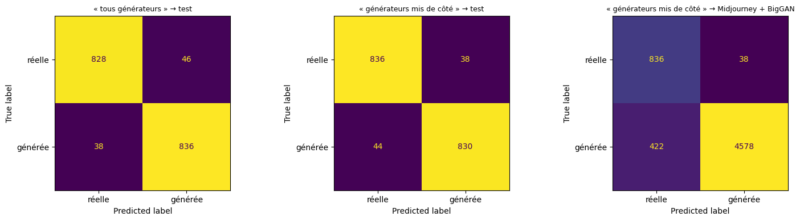
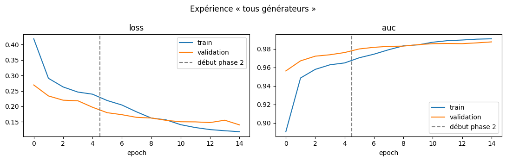
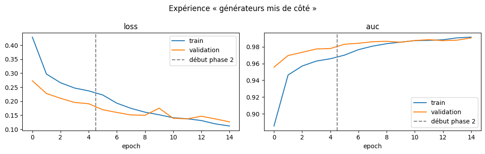
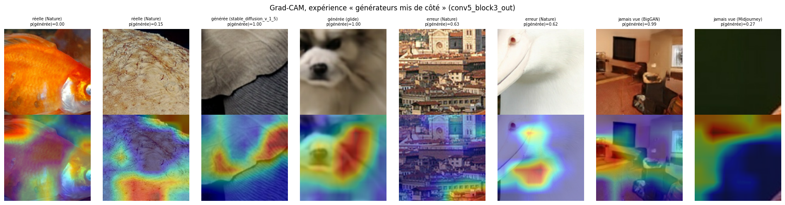

# Rapport d'entraînement n° 1

Premier entraînement complet du notebook [`real_vs_generated.ipynb`](../notebooks/real_vs_generated.ipynb), exécuté sur Kaggle le 2026-11-23. La version exécutée est [`real-vs-generated_executed.ipynb`](../notebooks/real-vs-generated_executed.ipynb). Les modèles et historiques ont été téléchargés dans `result_and_model/`, un dossier non versionné : 638 Mo, au-delà de la limite de GitHub.

Le protocole est celui du [document de cadrage](cadrage.md). En résumé :
- dataset `unbiased-tiny-genimage`, équilibré 50/50 ;
- crop natif de 128 px agrandi en 224 px ;
- ResNet50 pré-entraîné sur ImageNet ;
- phase 1 avec le backbone gelé (5 epochs), puis phase 2 avec dégel de `conv5` (10 epochs).

## Résumé en 5 points

1. **Environ 95 % d'accuracy et une AUC de 0,99** dans les deux expériences. Retirer Midjourney et BigGAN de l'entraînement ne change rien au score sur les générateurs connus.
2. **Bonne généralisation à des générateurs jamais vus** : 94,9 % des images BigGAN détectées, 88,2 % des images Midjourney.
3. **Entraînement sain mais pas fini** : pas de surapprentissage, mais la perte de validation baissait encore à la dernière epoch.
4. **⚠️ Fragilité découverte par le test de perturbation** : une vraie photo légèrement floutée ou recompressée en JPEG est classée « générée » dans ~40 % des cas.
5. **Grad-CAM cohérent** : le modèle regarde les zones texturées et se trompe sur les zones lisses.

---

## 1. Conditions d'exécution

- **Matériel** : Kaggle, 2 GPU T4. Le notebook n'en utilise qu'un. Précision mixte `mixed_float16`.
- **Versions** : TensorFlow 2.21.0, Keras 3.13.2.
- **Durée** : environ 20 s par epoch, après une première epoch plus lente (compilation et cache). Chaque expérience prend ~12 min, soit ~25 min d'entraînement au total.
- **Données** : 5 828 images réelles, 2 500 images par générateur. Split par expérience : 8 156 en train, 1 748 en validation, 1 748 en test.

## 2. Résultats principaux

| Évaluation | Images | Accuracy | F1 | AUC |
|---|---|---|---|---|
| « tous générateurs » → test | 1 748 | 0,952 | 0,952 | 0,990 |
| « générateurs mis de côté » → test | 1 748 | 0,953 | 0,953 | 0,991 |
| « générateurs mis de côté » → Midjourney + BigGAN | 5 874 | 0,922 | 0,952 | 0,986 |

- Sur les deux tests classiques, les erreurs sont **équilibrées** :
  - « tous générateurs » : 46 réelles prises pour générées, 38 générées prises pour réelles ;
  - « générateurs mis de côté » : 38 et 44.
- **Sur le test des générateurs mis de côté, l'accuracy (0,922) est trompeuse.** Ce test contient 5 000 images générées pour 874 réelles. Les mesures pertinentes sont l'AUC (0,986) et les taux par générateur ci-dessous.

## 3. Taux de bonnes réponses par source

Pour les images réelles, c'est la part classée « réelle ». Pour un générateur, c'est son taux de détection.

| Source | « tous générateurs » → test | « générateurs mis de côté » → test | « générateurs mis de côté » → jamais vus |
|---|---|---|---|
| Nature (réelles) | 0,947 | 0,957 | 0,957 |
| ADM | 0,968 | 0,949 | |
| BigGAN | 0,976 | *(mis de côté)* | **0,949** |
| Midjourney | 0,968 | *(mis de côté)* | **0,882** |
| VQDM | 0,904 | 0,909 | |
| GLIDE | 0,968 | 0,966 | |
| SD 1.5 | 0,968 | 0,971 | |
| Wukong | 0,944 | 0,954 | |

**Lecture :**
- **BigGAN, jamais vu, est détecté presque aussi bien que les générateurs connus** (94,9 %). C'est remarquable : c'est un GAN, alors que le modèle n'a appris que sur des modèles de diffusion.
- **Midjourney, jamais vu, perd environ 8 points** : 88,2 % contre 96,8 % quand il est vu à l'entraînement. C'est le coût du générateur inconnu, le résultat central de l'expérience. Une partie de cet écart vient probablement du crop (voir section 6).
- **VQDM est le générateur connu le plus difficile**, autour de 90 %, dans les deux expériences.
- **Aucun score suspect** : aucun générateur à 100 % pendant que les autres plafonnent. Le premier contrôle anti-triche ne signale rien.
- **Prudence pour l'oral** : la littérature rapporte ~72 % en cross-générateur sur GenImage, mais en entraînant sur un seul générateur. Ici, on entraîne sur 5. Les chiffres ne sont pas directement comparables.

## 4. Courbes d'entraînement

| Expérience | Meilleure perte de validation | Epoch | AUC de validation finale | Accuracy de validation finale |
|---|---|---|---|---|
| « tous générateurs » | 0,140 | 15 / 15 | 0,988 | 0,951 |
| « générateurs mis de côté » | 0,127 | 15 / 15 | 0,991 | 0,950 |

- **Pas de surapprentissage** : les courbes de validation suivent celles d'entraînement.
- La phase 2 (dégel de `conv5`) apporte un gain net : l'AUC de validation passe de ~0,977 à ~0,99.
- **L'entraînement n'est pas fini.** Dans les deux expériences, la meilleure perte de validation est atteinte à la **dernière** epoch, et l'arrêt anticipé ne s'est jamais déclenché. Quelques epochs de plus amélioreraient probablement un peu les résultats.

## 5. ⚠️ Test de perturbation : la découverte principale

On applique **la même** dégradation aux images de test **des deux classes**, puis on mesure la part classée « générée ».

| Perturbation | « tous générateurs » : réelles → « générée » | « tous générateurs » : générées → « générée » | « mis de côté » : réelles → « générée » | « mis de côté » : générées → « générée » |
|---|---|---|---|---|
| aucune | 0,053 | 0,957 | 0,043 | 0,950 |
| JPEG qualité 75 | **0,379** | 0,992 | **0,376** | 0,982 |
| flou gaussien σ = 1 | **0,419** | 0,985 | **0,403** | 0,978 |

**Constat** : les images générées restent détectées, et même un peu plus. En revanche, **près de 40 % des vraies photos basculent en « générée »** dès qu'on les recompresse en JPEG 75 ou qu'on les floute légèrement.

**Interprétation** : le modèle a appris qu'*une vraie photo contient des détails fins et nets* (bruit de capteur, micro-textures, hautes fréquences). Quand une photo réelle perd ces détails, elle ressemble à ce que le modèle associe aux images générées.

**Ce que ça veut dire** :
- **Le débiaisage du format a fonctionné.** On n'observe pas le raccourci « JPEG = réel » de GenImage brut : au contraire, recompresser pousse vers « générée ».
- **Le modèle s'appuie quand même sur un indice fragile.** Une vraie photo recompressée par un réseau social (WhatsApp, Instagram…) serait souvent accusée d'être générée. Le modèle est très bon sur des images « propres », mais ne serait pas fiable en conditions réelles.
- C'est exactement le rôle de ce contrôle. **C'est un excellent passage pour l'oral** : il montre qu'un score de 95 % ne suffit pas à conclure.

## 6. Grad-CAM

Modèle de l'expérience « générateurs mis de côté », couche `conv5_block3_out`.

- **Bonnes réponses** : le modèle se concentre sur des **zones texturées** (fourrure du chien, rides de l'éléphant, nageoires et écailles du poisson, texture d'une surface). Il ne regarde pas des zones de fond vides.
- **Les deux erreurs sont des photos réelles avec des zones lisses** : le plumage blanc d'un oiseau, une vue aérienne de Florence. Le modèle les classe « générées » (p = 0,62 et 0,63), en s'activant sur les zones peu texturées. **C'est cohérent avec le test de perturbation** : pour ce modèle, le lisse « fait IA ».
- **Exemple Midjourney raté (p = 0,27)** : le crop est un carré presque uniformément sombre. Avec un crop de 128 px dans une image de 1024 px, le modèle ne voit que 1/64 de l'image, parfois sans aucun détail exploitable. Ça explique en partie le score plus bas de Midjourney.
- **Exemple BigGAN bien détecté (p = 0,99)**, alors que ce générateur n'a jamais été vu à l'entraînement.

## 7. Pistes pour l'entraînement n° 2

Par ordre d'intérêt :

1. **Augmentation flou + JPEG aléatoire**, appliquée aux deux classes pendant l'entraînement, comme dans Wang et al. 2020 (probabilité 0,5, qualité JPEG 30–100). Elle corrige directement la fragilité de la section 5. Critère de succès : la part des réelles classées « générée » sous perturbation doit baisser nettement, sans perdre beaucoup d'accuracy sur le test propre.
2. **Plus d'epochs en phase 2** (par exemple 20, avec l'arrêt anticipé), puisque la perte de validation baissait encore.
3. **Plusieurs crops par image en évaluation**, en moyennant les prédictions. Ça devrait aider sur Midjourney, où un seul crop de 128 px peut tomber sur une zone vide, et ça ne demande pas de réentraînement.
4. **Mode test rapide dans un dossier séparé** (`outputs_smoke/`), pour qu'un test rapide ne puisse jamais être rechargé à la place d'un vrai modèle.

## 8. À retenir pour l'oral

- Le modèle atteint **95 % d'accuracy et une AUC de 0,99**, et reconnaît des **générateurs jamais vus** : 95 % sur BigGAN, 88 % sur Midjourney.
- **Le test de perturbation révèle une limite importante** : 40 % des vraies photos dégradées sont prises pour de l'IA. Le modèle a appris « netteté = réel ».
- Grad-CAM confirme cette lecture : le modèle s'appuie sur les textures et se trompe sur les zones lisses.
- C'est l'histoire à raconter : un score élevé ne suffit pas, il faut tester la robustesse. L'augmentation flou/JPEG est la correction naturelle.
