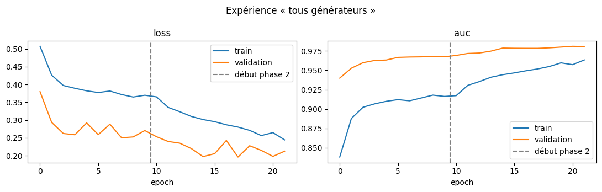
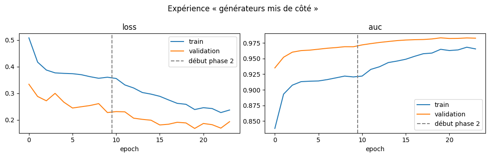
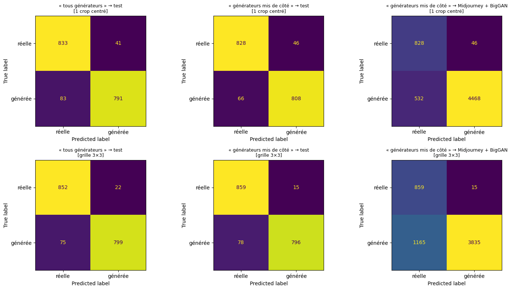
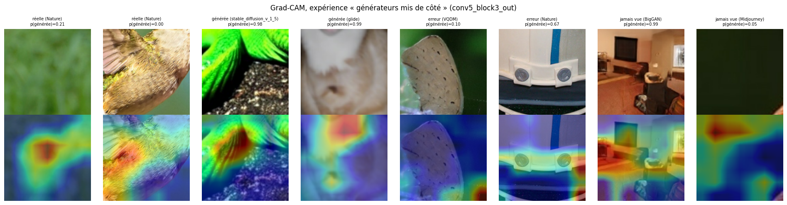

# Rapport d'entraînement n° 2

Deuxième entraînement complet du notebook [`real_vs_generated.ipynb`](../notebooks/real_vs_generated.ipynb), exécuté sur Kaggle le 2026-11-23. La version exécutée est [`real-vs-generated_executed2.ipynb`](../notebooks/real-vs-generated_executed2.ipynb). Les modèles et historiques (`train2_*`) sont dans `result_and_model/`, un dossier non versionné.

Ce rapport se lit en comparaison avec le [rapport d'entraînement n° 1](rapport_train1.md). Le protocole est celui du [document de cadrage](cadrage.md).

## Ce qui a changé depuis l'entraînement n° 1

| | Entraînement n° 1 | Entraînement n° 2 |
|---|---|---|
| Augmentation (entraînement seulement, deux classes) | aucune | flou gaussien (p = 0,5, σ entre 0 et 2) et recompression JPEG (p = 0,5, qualité entre 50 et 100) |
| Epochs maximum | 5 + 10 | 10 + 30 |
| Arrêt anticipé | phase 2 seulement | les deux phases (patience 4, meilleurs poids restaurés) |
| Évaluation | 1 crop centré | 1 crop centré **et** grille de 3 × 3 crops (moyenne des probabilités) |
| Test de perturbation | JPEG 75, flou σ = 1 | en plus : JPEG 40, flou σ = 2,5, réduction ×0,5 puis agrandissement |

## Résumé en 5 points

1. **La fragilité « net = réel » est en grande partie corrigée.** Sous JPEG 75 ou flou σ = 1, la part de vraies photos classées « générée » passe d'environ **40 % à environ 15 %**.
2. **Le prix : environ 2 points sur les images propres.** L'accuracy passe de 0,95 à 0,93 et l'AUC de 0,99 à 0,98. La baisse porte sur la détection des images générées, pas sur les réelles.
3. **Les générateurs jamais vus restent bien détectés** avec 1 crop : 93,8 % pour BigGAN, 84,9 % pour Midjourney, soit 1 à 3 points de moins qu'au premier entraînement.
4. **La grille 3 × 3 aide sur les tests classiques mais effondre Midjourney jamais vu** (de 84,9 % à 59,6 %), alors que l'AUC reste à 0,98. C'est un problème de seuil, pas de classement.
5. **Limite restante** : un flou fort (σ = 2,5), plus fort que ceux vus à l'entraînement, fait encore basculer environ la moitié des vraies photos.

---

## 1. Conditions d'exécution

- **Matériel** : Kaggle, 2 GPU T4, dont un seul utilisé. Précision mixte `mixed_float16`.
- **Versions** : TensorFlow 2.21.0, Keras 3.13.2.
- **Durée** : environ 60 s par epoch. La première epoch de chaque expérience est plus lente (190 à 290 s) parce qu'elle remplit le cache des images décodées. Chaque expérience prend environ 25 min.
- **Données** : identiques au premier entraînement. Même graine, donc mêmes splits : 8 156 images en train, 1 748 en validation, 1 748 en test.

## 2. Courbes d'entraînement

| Expérience | Epochs effectuées | Meilleure epoch (phase 2) | Meilleure perte de validation | AUC de validation | Accuracy de validation |
|---|---|---|---|---|---|
| « tous générateurs » | 10 + 12 | 8 | 0,196 (train 1 : 0,140) | 0,978 | 0,917 |
| « générateurs mis de côté » | 10 + 14 | 10 | 0,168 (train 1 : 0,127) | 0,983 | 0,934 |

- **L'arrêt anticipé a fonctionné** :
  - en phase 1, il garde l'epoch 8 pour « tous générateurs » et l'epoch 10 pour « mis de côté » ;
  - en phase 2, il arrête l'entraînement aux epochs 12 et 14, loin du maximum de 30.

  Le nombre d'epochs n'est plus le facteur limitant.
- **La perte de validation oscille davantage** qu'au premier entraînement, d'une epoch à l'autre. C'est attendu, puisque chaque image d'entraînement est dégradée au hasard.
- **L'accuracy d'entraînement est sous celle de validation** (environ 0,89 contre 0,92). Ce n'est pas une anomalie : seul l'entraînement est augmenté, donc ses images sont plus difficiles.
- **Les pertes de validation sont plus élevées qu'au premier entraînement.** C'est cohérent avec la baisse de score sur les images propres (section 3).

## 3. Résultats principaux

| Évaluation | Images | Train 1 : acc / F1 / AUC | Train 2, 1 crop : acc / F1 / AUC | Train 2, grille 3 × 3 : acc / F1 / AUC |
|---|---|---|---|---|
| « tous générateurs » → test | 1 748 | 0,952 / 0,952 / 0,990 | 0,929 / 0,927 / 0,981 | **0,945 / 0,943 / 0,987** |
| « générateurs mis de côté » → test | 1 748 | 0,953 / 0,953 / 0,991 | 0,936 / 0,935 / 0,984 | **0,947 / 0,945 / 0,991** |
| « générateurs mis de côté » → Midjourney + BigGAN | 5 874 | 0,922 / 0,952 / 0,986 | 0,902 / 0,939 / 0,980 | 0,799 / 0,867 / 0,982 |

Erreurs (réelles prises pour générées / générées prises pour réelles) :

| Évaluation | Train 1 | Train 2, 1 crop | Train 2, grille 3 × 3 |
|---|---|---|---|
| « tous générateurs » → test | 46 / 38 | 41 / 83 | 22 / 75 |
| « générateurs mis de côté » → test | 38 / 44 | 46 / 66 | 15 / 78 |
| « mis de côté » → Midjourney + BigGAN | 38 / 590 | 46 / 532 | 15 / 1 165 |

**Lecture :**
- Avec 1 crop, les erreurs ne sont **plus équilibrées** : le modèle rate davantage d'images générées (83 contre 38 au premier entraînement), alors que les fausses alertes sur les réelles ne bougent presque pas.
- **La grille 3 × 3 récupère l'essentiel de la perte sur les tests classiques** : l'AUC revient à 0,987 et 0,991, au niveau du premier entraînement. Les fausses alertes sur les réelles sont divisées par 2 à 3.
- Sur le test des générateurs mis de côté, l'accuracy reste trompeuse, avec 5 000 images générées pour 874 réelles. Les mesures pertinentes sont l'AUC et les taux par générateur (section 4).

## 4. Taux de bonnes réponses par source

Pour les images réelles, c'est la part classée « réelle ». Pour un générateur, c'est son taux de détection. Chaque générateur compte environ 125 images au test classique : **une image vaut 0,8 point**, donc un écart de 2 à 3 points sur un générateur relève du bruit.

### Expérience « tous générateurs » → test

| Source | Train 1 | Train 2, 1 crop | Train 2, grille 3 × 3 |
|---|---|---|---|
| Nature (réelles) | 0,947 | 0,953 | **0,975** |
| ADM | 0,968 | 0,904 | 0,904 |
| BigGAN | 0,976 | 0,952 | 0,952 |
| Midjourney | 0,968 | 0,880 | 0,896 |
| VQDM | 0,904 | 0,864 | 0,880 |
| GLIDE | 0,968 | 0,912 | 0,896 |
| SD 1.5 | 0,968 | 0,936 | 0,952 |
| Wukong | 0,944 | 0,888 | 0,920 |

### Expérience « générateurs mis de côté »

| Source | Train 1 | Train 2, 1 crop | Train 2, grille 3 × 3 |
|---|---|---|---|
| Nature (réelles) | 0,957 | 0,947 | **0,983** |
| ADM | 0,949 | 0,926 | 0,874 |
| VQDM | 0,909 | 0,874 | 0,886 |
| GLIDE | 0,966 | 0,926 | 0,886 |
| SD 1.5 | 0,971 | 0,949 | 0,949 |
| Wukong | 0,954 | 0,948 | 0,960 |
| **BigGAN (jamais vu)** | 0,949 | **0,938** | 0,938 |
| **Midjourney (jamais vu)** | 0,882 | **0,849** | **0,596** |

**Lecture :**
- **La baisse due à l'augmentation touche tous les générateurs**, de 2 à 9 points. Les plus touchés sont ADM, GLIDE, Wukong et Midjourney lorsqu'il est vu à l'entraînement. Explication probable : une partie des indices qui trahissaient une image générée sont des détails fins, et l'augmentation apprend justement au modèle à ne plus s'y fier.
- **La généralisation aux générateurs jamais vus tient** : BigGAN perd 1 point et Midjourney 3 points avec 1 crop.
- **VQDM reste le générateur connu le plus difficile**, autour de 87 à 88 %.
- **Aucun score suspect**, aucun générateur à 100 % : le premier contrôle anti-triche ne signale toujours rien.

### Pourquoi la grille effondre Midjourney jamais vu

- La grille fait passer la détection de Midjourney jamais vu de 84,9 % à **59,6 %**, alors que l'**AUC reste à 0,982**. Le modèle classe donc toujours les images Midjourney plus « générées » que les réelles : c'est le **seuil de 0,5** qui ne convient plus, pas le classement.
- **Hypothèse** : les images Midjourney ont souvent un sujet net au centre et des **fonds lisses ou flous** sur les bords (effet bokeh). Les 8 crops autour du centre tombent sur ces fonds. Un modèle qui n'a jamais vu Midjourney les juge « réels », et la moyenne des 9 probabilités tire toute l'image vers « réelle ».
- **Quand Midjourney est vu à l'entraînement**, la grille l'améliore légèrement (de 0,880 à 0,896) : le modèle a appris que ces fonds lisses peuvent être générés.
- **BigGAN ne change pas avec la grille (0,938)** : ses images font 128 px, donc les 9 crops de la grille sont le même crop.
- **Conséquence** : la moyenne de plusieurs crops réduit les fausses alertes sur les réelles, mais elle **dilue** le signal quand seule une partie de l'image trahit le générateur. Agréger avec le **maximum** des 9 probabilités au lieu de la moyenne, ou avec la moyenne des 3 crops les plus « générés », devrait éviter cette dilution. C'est à tester, sans réentraînement.

## 5. Test de perturbation : la correction a fonctionné

On applique **la même** dégradation aux images de test **des deux classes**, puis on mesure la part classée « générée ».

### Vraies photos classées « générée » (fausses alertes, plus bas = mieux)

| Perturbation | « tous » train 1 | « tous » train 2 | « mis de côté » train 1 | « mis de côté » train 2 |
|---|---|---|---|---|
| aucune | 0,053 | 0,047 | 0,043 | 0,053 |
| JPEG qualité 75 | **0,379** | **0,154** | **0,376** | **0,174** |
| flou gaussien σ = 1 | **0,419** | **0,140** | **0,403** | **0,159** |
| JPEG qualité 40 (plus fort) | — | 0,130 | — | 0,145 |
| réduction ×0,5 puis agrandissement (jamais vu) | — | 0,208 | — | 0,223 |
| flou gaussien σ = 2,5 (plus fort) | — | **0,468** | — | **0,535** |

### Images générées classées « générée » (détection, plus haut = mieux)

| Perturbation | « tous » train 2 | « mis de côté » train 2 |
|---|---|---|
| aucune | 0,905 | 0,924 |
| JPEG qualité 75 | 0,919 | 0,945 |
| flou gaussien σ = 1 | 0,911 | 0,939 |
| JPEG qualité 40 | 0,891 | 0,900 |
| réduction ×0,5 puis agrandissement | 0,935 | 0,957 |
| flou gaussien σ = 2,5 | 0,932 | 0,950 |

**Lecture :**
- **Sur les dégradations couvertes par l'augmentation** (JPEG 75, JPEG 40, flou σ = 1), les fausses alertes passent d'environ 40 % à environ 15 % : **presque divisées par 3**. Le critère de succès fixé dans le premier rapport est atteint : les fausses alertes sous perturbation baissent nettement, au prix d'environ 2 points sur les images propres.
- **JPEG 40, plus fort que tout ce qui a été vu à l'entraînement** (qualité minimale de 50), reste bien géré (13 à 15 %). La robustesse à la compression déborde un peu de la plage d'entraînement.
- **La réduction puis agrandissement, jamais vue**, donne 21 à 22 % de fausses alertes. C'est moins bien que pour les dégradations vues, mais bien mieux que les 40 % du premier entraînement face à une dégradation légère.
- **Le flou σ = 2,5 casse encore le modèle** : environ la moitié des vraies photos basculent. L'augmentation s'arrête à σ = 2, et le modèle ne généralise pas au-delà. Le lien « lisse = généré » n'a pas disparu, il a été repoussé.
- **La détection des images générées ne baisse pas sous perturbation** (0,89 à 0,96). Le modèle ne s'est pas contenté de répondre « réelle » plus souvent.

## 6. Grad-CAM

Modèle de l'expérience « générateurs mis de côté », couche `conv5_block3_out`, 1 crop centré.

- **Une photo réelle presque entièrement floue** (de l'herbe) est bien classée « réelle » (p = 0,21). Au premier entraînement, ce type d'image partait en « générée ». C'est l'effet visible de l'augmentation.
- **Une image GLIDE lisse et floue** (un pelage) est détectée (p = 0,99). Le modèle ne se contente plus de la netteté : il trouve d'autres indices dans les zones lisses.
- **Les images bien classées** activent toujours des zones structurées : plumes, écailles, bord du sujet.
- **Erreur sur une image réelle** : un objet en plastique blanc très lisse, classé « généré » (p = 0,67). Les surfaces manufacturées lisses restent un point faible.
- **Erreur VQDM** (p = 0,10) : une texture naturelle crédible, sans artefact visible dans le crop.
- **BigGAN, jamais vu, est détecté** (p = 0,99).
- **Midjourney, jamais vu, est encore raté sur un crop presque uniformément sombre** (p = 0,05). C'est le même problème qu'au premier entraînement : un crop de 128 px voit 1/64 d'une image de 1024 px, et peut ne contenir aucun détail exploitable.

## 7. Bilan entraînement n° 1 contre n° 2

| Critère | Train 1 | Train 2 | Verdict |
|---|---|---|---|
| AUC test « tous générateurs » (1 crop) | 0,990 | 0,981 | légère baisse |
| AUC test « tous générateurs » (grille) | — | 0,987 | récupère presque tout |
| BigGAN jamais vu | 0,949 | 0,938 | stable |
| Midjourney jamais vu (1 crop) | 0,882 | 0,849 | légère baisse |
| Fausses alertes sous JPEG 75 | 0,38 | 0,15–0,17 | **nette amélioration** |
| Fausses alertes sous flou σ = 1 | 0,40–0,42 | 0,14–0,16 | **nette amélioration** |
| Fausses alertes sous flou σ = 2,5 | non testé | 0,47–0,54 | limite restante |

**Le modèle du deuxième entraînement est le meilleur des deux pour un usage réel.** Il perd un peu sur des images propres, mais il ne prend plus une photo recompressée pour une image générée. C'est le modèle à présenter. Le premier entraînement sert de point de comparaison : il montre pourquoi l'augmentation était nécessaire.

## 8. Pistes, sans réentraînement

1. **Agrégation de la grille par maximum** (ou moyenne des 3 crops les plus « générés ») au lieu de la moyenne, pour ne plus diluer le signal sur Midjourney.
2. **Seuil choisi sur la validation** plutôt que fixé à 0,5. L'AUC de 0,98 sur Midjourney + BigGAN montre qu'un meilleur seuil existe.
3. **AUC par générateur** sur le test des générateurs mis de côté, pour séparer Midjourney de BigGAN dans la mesure de classement.

Avec réentraînement, si le temps le permet : étendre l'augmentation de flou jusqu'à σ = 3, et ajouter la réduction puis agrandissement comme augmentation.

## 9. À retenir pour l'oral

- **L'histoire complète en deux entraînements** :
  - le premier modèle atteint 95 % mais confond « flou » et « IA » ;
  - le test de perturbation le révèle ;
  - l'augmentation flou + JPEG divise les fausses alertes par 3, pour environ 2 points de score propre.
- **Les générateurs jamais vus restent détectés** : 94 % pour BigGAN, 85 % pour Midjourney.
- **La grille de crops est à double tranchant** : elle améliore les tests classiques mais dilue le signal sur Midjourney jamais vu. Un bon exemple de choix d'évaluation qui change la conclusion.
- **Limite honnête** : un flou plus fort que ceux vus à l'entraînement trompe encore le modèle. La robustesse vient de l'augmentation, elle ne s'étend pas d'elle-même au-delà.
